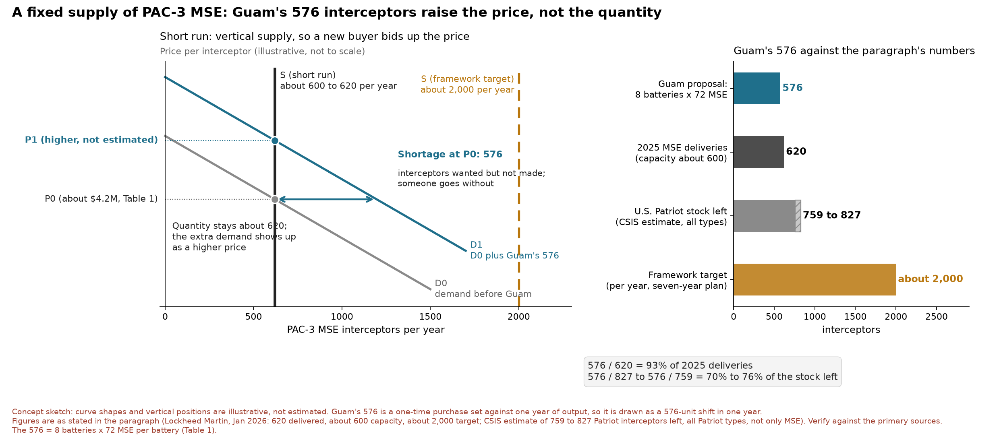

**The Global Costs of Patriot Missile Deterrence in Guam**

Richie Gaas

Distance Learning Executive MBA Program, Shidler College of Business

BUS 620: Macro- and Macro-Economic Foundations for Managers

Professor Adam Stauffer

October 9, 2026

**Introduction**. Guam calls itself "Where America's Day Begins," but if a war with China ever comes, this island may be where it begins too. Beijing’s nickname for their DF-26 ballistic missile is “Guam Express,” and they have released videos simulating strikes on a runway that closely resembled Andersen Air Force Base in Guam (Shaikh, 2018; Tian, 2020). America's answer is missile defense, a network of radars and interceptors, built to find and destroy incoming missiles in mid-flight. Because a single interceptor can cost anywhere from about $2 million to $30 million, the question is what mix of missile defense capabilities should be bought and deployed to Guam (Missile Defense Advocacy Alliance [MDAA], 2025).

**Background**. In September 2025, the Department of War approved a roughly $8 billion dollar, 360-degree shield called the Guam Defense System, or GDS (Arms Control Association, 2025). The plan is to field it in phases, with elements arriving in fiscal year 2027 and the last by fiscal year 2032. GDS is a missile defense network that incorporates disparate missile systems into a unified, layered defense blanket for the island. The House and Senate Appropriations Committees were faced with a framework like our cohort’s first economics problem set, the bed-farm model: sixteen war sites, three missile capabilities, and an $8 billion dollar cap. Table 1 introduces each interceptor, what it can stop, and what it costs to field.

**Table 1. Guam Defense System interceptors**

| Interceptor | Threats | Cost per interceptor | Total interceptors employed for one capability | Total Cost for one capability (to include interceptors) |
|---|---|---:|---:|---:|
| Patriot Missile System (MSE) | BM, CM, ABT | $4.2M | 72 | $0.70B |
| Patriot Missile System (CRI)\* | BM, CM, ABT | $3.7M | 96 | $0.76B |
| THAAD | BM | $12.7M | 48 | $1.18B |
| Aegis Weapon System SM-3 IIA | BM | $27.9M | 8‡ | $4.58B |
| Aegis Weapon System SM-6 | BM, CM, ABT, UAS, HGV§ | $3.5–9.6M | 8‡ | $2.24–2.82B |
| Aegis Weapon System SM-2\* | CM, ABT | $2.0–2.1M | 8‡ | $2.09–2.10B |

**Threats:** BM = ballistic missile · CM = cruise missile · ABT = aircraft · UAS = drone · HGV = hypersonic (terminal phase). \* Not confirmed for Guam. † Model placeholder, not yet sourced. ‡ One 8-cell Mk 41 launcher; actual Aegis loadouts are classified. § Hypersonic intercept still in testing; terminal-phase ballistic intercept demonstrated.

**Total interceptors employed for one capability:** Patriot battery = 6 launchers × 12 MSE or × 16 CRI; THAAD battery = 6 launchers × 8. Mk 41 launcher = one 8-cell module, one SM-2, SM-3, or SM-6 per cell; Aegis Ashore sites use 3 launchers (24 interceptors). Number of Mk 41 launchers on Guam not yet verified.

**Total cost** = one system (Patriot battery about $0.4B without missiles; THAAD battery about $0.57B, half of a 2013 two-battery sale; Aegis Guam $1.9B) plus a full load of that interceptor. Aegis rows assume 96 cells† holding that one missile; the system cost is counted once in practice. Guam's existing THAAD battery is already paid for. M = million, B = billion; years vary, not inflation-adjusted.

**Sources:** GAO-25-108187 (2025); Arms Control Association (2025); Brahy, Army Recognition (2026); Cancian and Karako, CSIS (2022); CSIS Missile Defense Project (2021, 2023, 2026); Missile Defense Agency (2025); U.S. Navy (2021); Lockheed Martin (2024); Norsk Luftvern (2026); Cicurel, JINSA (2025); Rumbaugh, CSIS (2024); Missile Defense Advocacy Alliance (2025).

**Thesis Statement**. Guam is currently protected by a Navy Aegis Weapon System and an Army Terminal High Altitude Area Air Defense (THAAD) battery. These systems have coverage against ballistic missiles like China’s DF-26, but limited coverage against other kinds of threats, and removing these capabilities and deploying them elsewhere runs into sunk costs. So, the next dollar should be invested in one missile system with interceptors that can get the most bang for the buck to defend the island. The Department of War wants to deploy an uncommitted amount of Patriot Missile Systems with an undisclosed number of Patriot Advanced Capability-3 Missile Segment Enhanced (PAC-3 MSE) interceptors. This missile capability covers the threat gap and is highly effective against aircraft, cruise missiles, and drones (Norsk, 2026). The suggestion is to deploy a total of 8 Patriot Missile Systems with 576 MSE PAC-3 interceptors, to adequately achieve holistic island defense for Guam. This would cost about $5.6 billion of the $8 billion allocated for GDS, and it seems to be the solution the Department of War wants to execute (Trevithick, 2026). However, unlike our cohort’s bed-farm model, this research discovers that there are macroeconomic implications of a missile system-war site model for Guam that affect other countries who rely on the same capability.

**A Fixed Supply**. The 2026 war with Iran consumed nearly two-thirds of the U.S. Patriot inventory. Analysts at the Center for Strategic and International Studies estimate that only 759 to 827 Patriot interceptors remain in the U.S. stock, which is about a third of the pre-war stock (Korte, 2026). Every PAC-3 MSE interceptor comes off the same production line. In 2025, Lockheed Martin delivered 620 PAC-3 MSE interceptors while working at a capacity of roughly 600 per year. Only in January 2026 did the Department of War sign a seven-year framework to raise that capacity to about 2,000 per year (Lockheed Martin [LM], 2026). Measured against those numbers, Guam's proposed 576 MSE interceptors equal 93 percent of an entire year of 2025 production and 70 to 76 percent of what the United States has left. In the short run, interceptor supply behaves like a nearly vertical supply curve. Factories cannot add production lines overnight, and a new buyer cannot call more missiles into existence, it can only raise their price.

**Crowding Out Allies**. When output is fixed, every interceptor the U.S. government buys for Guam is one that cannot go to an ally. Taiwan plans to spend about US$636.9 million on 102 PAC-3 MSE interceptors, and its officials warned that U.S. restocking after the Middle East conflict could delay delivery (Taiwan News, 2026). Guam's order alone is more than five and a half times Taiwan's. In Ukraine, Patriot crews had exhausted their interceptor stocks by August 2026, and the country cannot manufacture PAC-3s at the scale it needs (Dysa, 2026; Servaes, 2026). U.S. forces and Gulf partners in the Middle East are drawing on the same depleted stockpile (Cicurel, 2025). The opportunity cost of a PAC-3 parked on Guam is not measured only in dollars, it is a PAC-3 that is not defending Kyiv or Taipei. Taiwan sits on the front line of the same Chinese missile threat Guam is preparing for, so a Guam-first allocation that delays Taiwan's defenses may weaken the very deterrence the Pacific theater depends on.

**Trade Effects**. Trade ties the Guam decision to the wider economy as well. Patriot sales to allies are U.S. exports, and diverting output to Guam lowers those exports while pushing allies toward substitutes. Viable options include NASAMS and the IRIS-T missile systems, which can handle less demanding threats but cannot fully replace Patriot against ballistic missiles (MDAA, 2025). Allied production offers a way out, grounded in comparative advantage. Japan, which builds PAC-3 missiles under license, completed its first export of those missiles to the United States in 2025 to replenish stocks drained by aid to Ukraine (Japan Times, 2025). Expanding co-production adds to global supply instead of dividing a fixed amount. Yet, the production side carries some risk too. In December 2024, China banned exports of gallium, germanium, and antimony to the United States, citing their military uses (Baskaran, 2024). These strategic metals are cornerstones in interceptor-building, and it seems that China may be exploiting that supply-chain exposure, directly affecting the US defense posture in the Pacific.

**Recommendation**. The House and Senate appropriations committees should use their current Guam Defense System fielding schedule to back-load Guam's PAC-3 MSE purchases into FY2029 through FY2032, when the seven-year production ramp is moving toward 2,000 interceptors per year, rather than compete with Taiwan and Ukraine for today's roughly 600 (LM, 2026). Part of the funding should go to Lockheed Martin’s production capacity itself, which shifts the supply curve outward instead of simply bidding up the price. This recommendation requires a strategy to acquire critical minerals from alternate sources to address the risk exposed by China’s export ban. With a fixed supply, putting Guam first raises the price for every buyer and weakens many global defense partners, to include allies who help deter China in the first place. Phasing the purchase still delivers Guam's 576 interceptors by 2032, with less pressure on price and less damage to the allies the United States is counting on around the world.

**References**

Arms Control Association. (2025, October). Guam missile defense system receives go-ahead. *Arms Control Today*. https://www.armscontrol.org/act/2025-10/news-briefs/guam-missile-defense-system-receives-go-ahead

Baskaran, G., & Schwartz, M. (2024, December 4). *China imposes its most stringent critical minerals export restrictions yet amidst escalating U.S.-China tech war*. Center for Strategic and International Studies. https://www.csis.org/analysis/china-imposes-its-most-stringent-critical-minerals-export-restrictions-yet-amidst

Cancian, M. F., & Karako, T. (2022, December 16). *Patriot to Ukraine: What does it mean?* Center for Strategic and International Studies. https://www.csis.org/analysis/patriot-ukraine-what-does-it-mean

Cicurel, A. (2025, July 21). *Burn rate: Missile and interceptor cost estimates during the U.S.-Israel-Iran war*. Jewish Institute for National Security of America. https://jinsa.org/wp-content/uploads/2025/07/Cost-Estimates-During-the-U.S.-Israel-Iran-War-07-21-25.pdf

CSIS Missile Defense Project. (2021, June 30). *Terminal High Altitude Area Defense (THAAD)*. Missile Threat, Center for Strategic and International Studies. https://missilethreat.csis.org/system/thaad/

CSIS Missile Defense Project. (2023a, March 9). *Standard Missile-3 (SM-3)*. Missile Threat, Center for Strategic and International Studies. https://missilethreat.csis.org/defsys/sm-3/

CSIS Missile Defense Project. (2023b, August 23). *Patriot*. Missile Threat, Center for Strategic and International Studies. https://missilethreat.csis.org/system/patriot/

CSIS Missile Defense Project. (2026a, January 28). *Standard Missile-6 (SM-6)*. Missile Threat, Center for Strategic and International Studies. https://missilethreat.csis.org/defsys/sm-6/

CSIS Missile Defense Project. (2026b, August 19). *Aegis Ashore*. Missile Threat, Center for Strategic and International Studies. https://missilethreat.csis.org/defsys/aegis-ashore/

Dysa, Y. (2026, August 5). Ukraine says missile interceptor deliveries have fallen to third of 2025 level. Reuters. https://www.internazionale.it/ultime-notizie-reuters/2026/08/05/ukraine-says-missile-interceptor-deliveries-have-fallen-to-third-of-2025-level

Japan completes PAC-3 missile export to U.S. (2025, November 20). *The Japan Times*. https://www.japantimes.co.jp/news/2025/11/20/japan/japan-us-missile-export-pac-3/

Korte, L. (2026, July 30). Iran war has consumed nearly 67% of US Patriot interceptor stockpile, report says. *Stars and Stripes*. https://www.stripes.com/theaters/middle_east/2026-07-30/iran-war-missile-stockpiles-patriots-22406307.html

Lockheed Martin. (2026, January 6). *Lockheed Martin and Department of War advance landmark acquisition transformation to accelerate PAC-3 MSE production* [Press release]. https://news.lockheedmartin.com/2026-01-06-Lockheed-Martin-and-Department-of-War-Advance-Landmark-Acquisition-Transformation-to-Accelerate-PAC-3-R-MSE-Production

Missile Defense Advocacy Alliance. (2025, July 16). *Missile interceptors by cost*. https://www.missiledefenseadvocacy.org/missile-defense-systems/missile-interceptors-by-cost/

Norsk, Luftvern. (2026, March 9). *Patriot missile defense system: Cost analysis and performance comparison*. https://norskluftvern.com/2026/03/09/patriot-missile-defense-system-cost-analysis-and-performance-comparison/

Servaes, A. (2026, August 16). Ukraine's U.S.-made Patriot missile shortage strains air defenses as Russia intensifies ballistic strikes. *Army Recognition*. https://www.armyrecognition.com/news/army-news/2026/ukraines-u-s-made-patriot-missile-shortage-strains-air-defenses-as-russia-intensifies-ballistic-strikes

Shaikh, S. (2018, April 20). *China commissions DF-26 missile brigade*. Missile Threat, Center for Strategic and International Studies. https://missilethreat.csis.org/china-commissions-df-26-missile-brigade/

Taiwan concerned Iran conflict could delay Patriot missile procurement. (2026, March 4). *Taiwan News*. https://www.taiwannews.com.tw/news/6313923

Tian, Y. L., & Blanchard, B. (2020, September 21). China air force video appears to show simulated attack on U.S. air base on Guam. *Reuters*. https://www.nasdaq.com/articles/china-air-force-video-appears-to-show-simulated-attack-on-u.s.-air-base-on-guam-2020-09-21

Trevithick, J., & Altman, H. (2026, August 17). New Patriot battalion to bolster Guam's defenses within months. *The War Zone*. https://www.twz.com/land/new-patriot-battalion-to-bolster-guams-defenses-within-months
